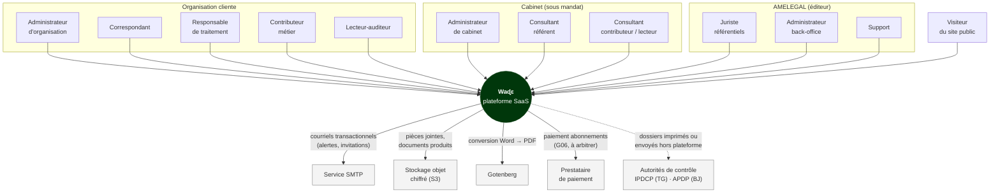
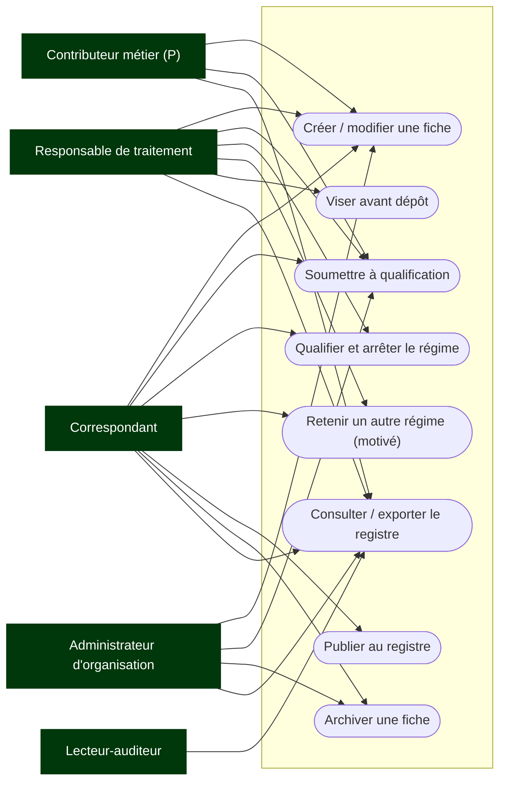
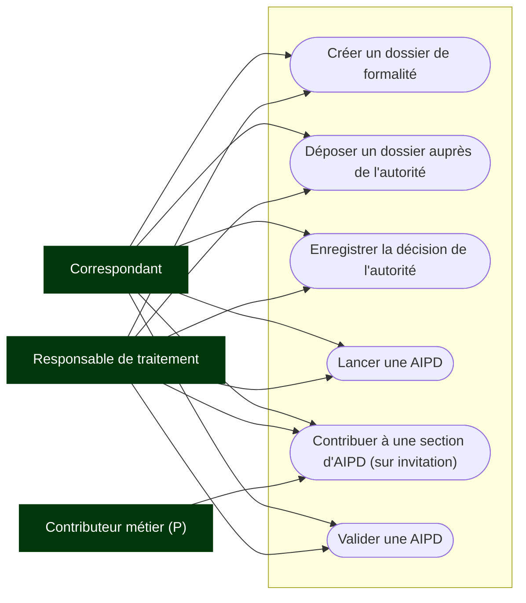
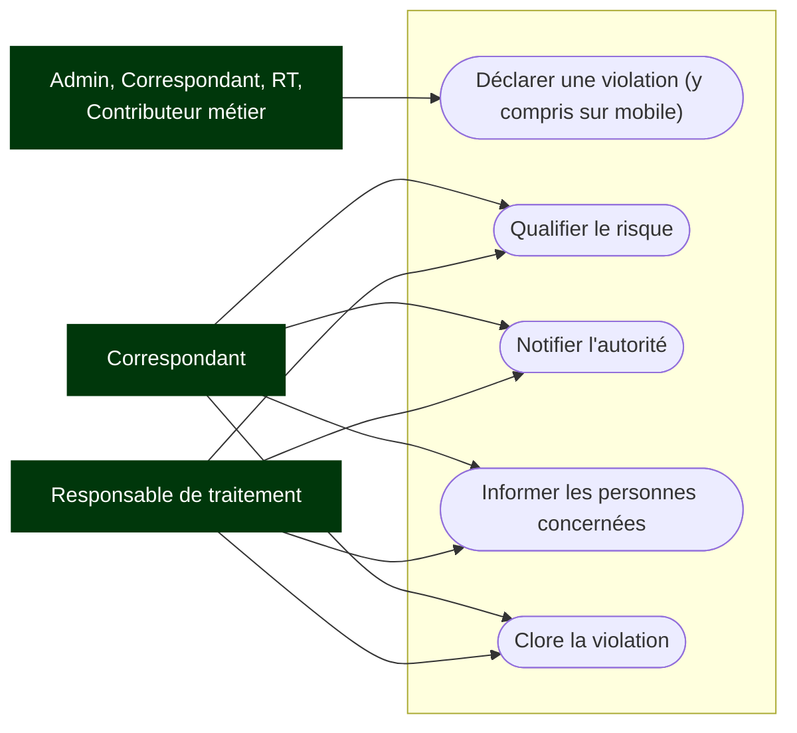
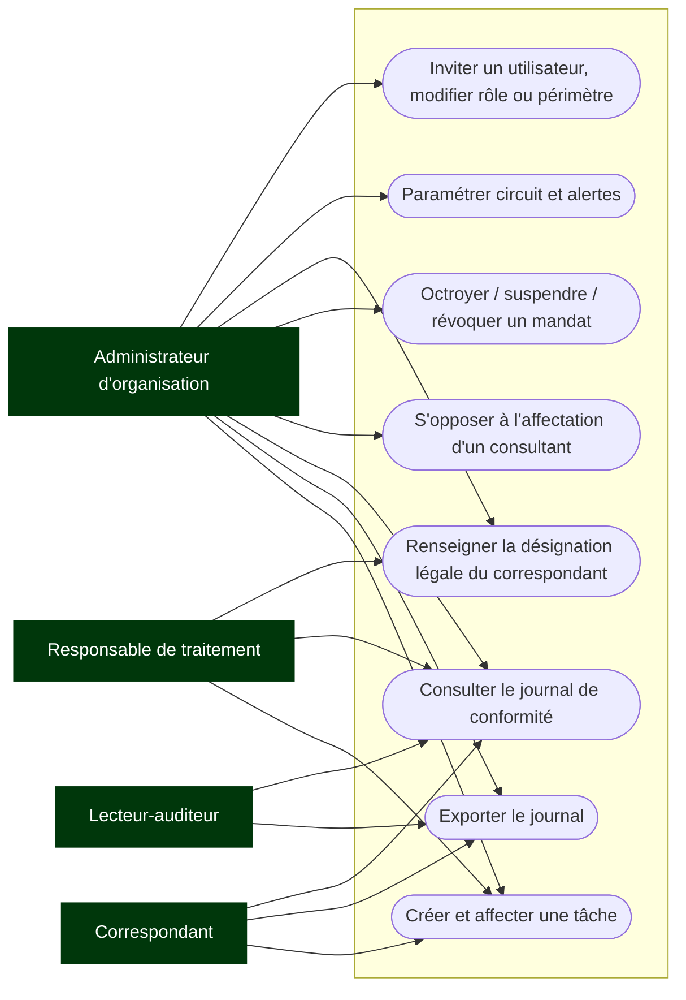
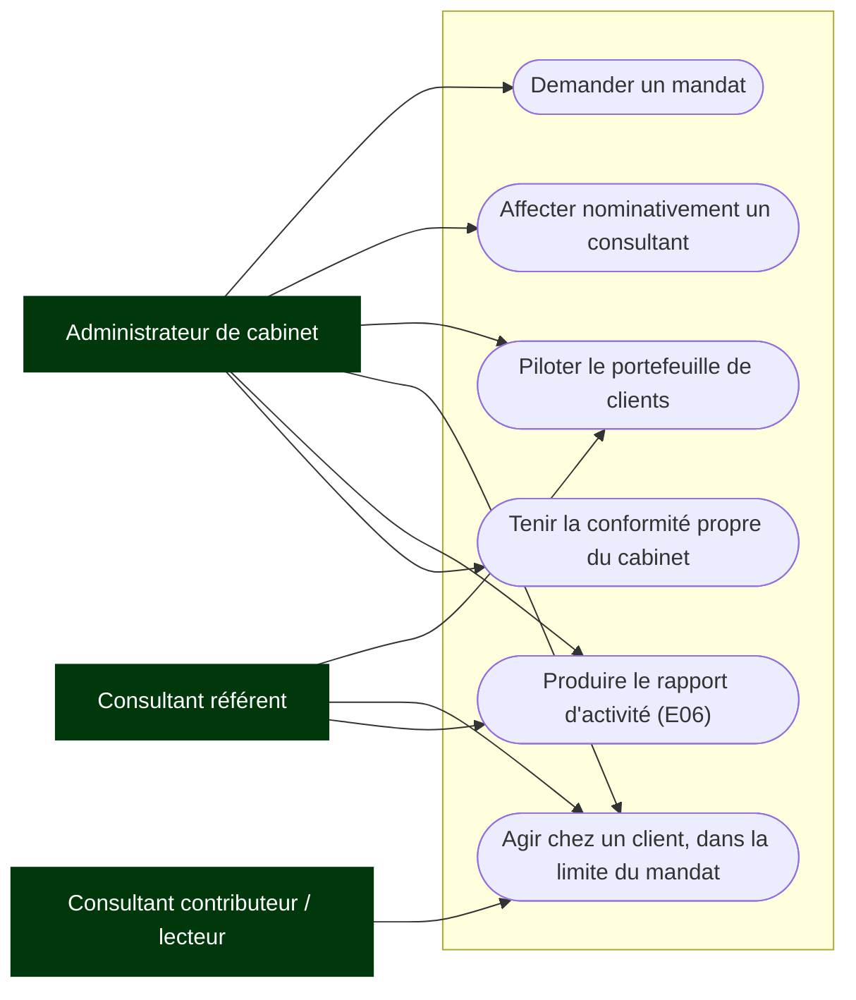
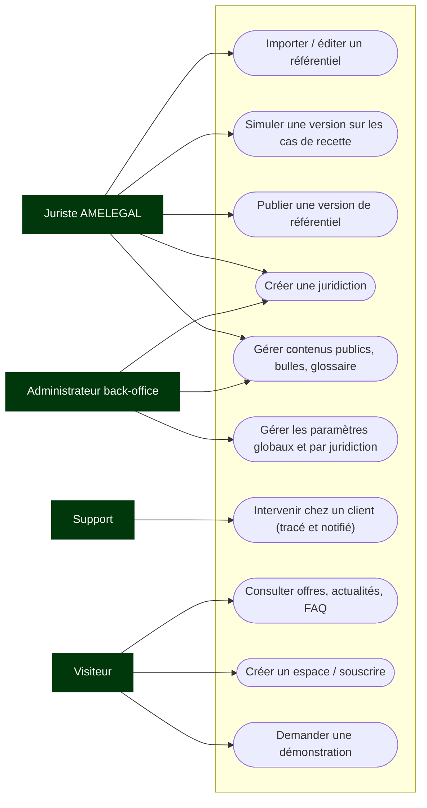

# 1. Contexte et cas d'utilisation

## 1.1 Diagramme de contexte

Waɖɛ au centre, ses utilisateurs et les systèmes externes avec lesquels il échange.

> Il n'existe **pas d'interface électronique** avec les autorités : le dépôt se fait par voie
> électronique (courriel), postale ou au guichet (art. 413 BJ ; à renseigner pour l'IPDCP).
> Waɖɛ produit le dossier, l'utilisateur le dépose, puis enregistre les jalons (accusé, décision).

## 1.2 Cas d'utilisation par acteur

Les droits détaillés sont ceux de la matrice G04. P = limité au périmètre de services de l'utilisateur. Un consultant de cabinet exerce, chez le client, les prérogatives du rôle d'organisation correspondant à son rôle de cabinet, dans la limite du mandat (G04 §2).

### Registre

### Formalités et analyses d'impact

### Violations de données

### Gouvernance et traçabilité

### Espace cabinet

### Back-office AMELEGAL et site public

