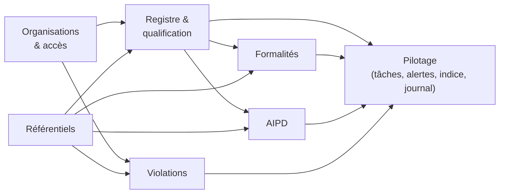
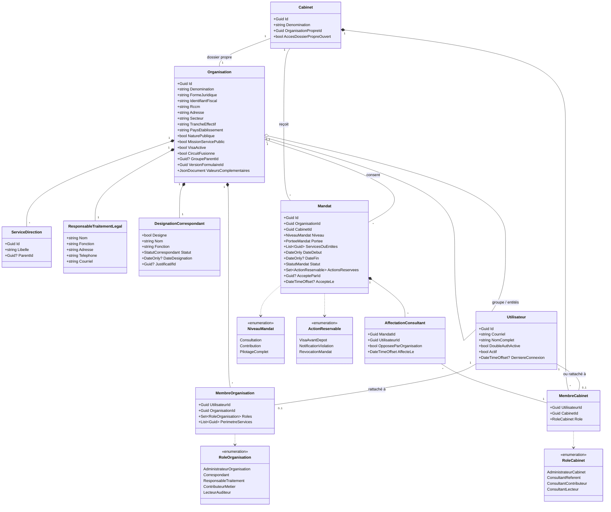
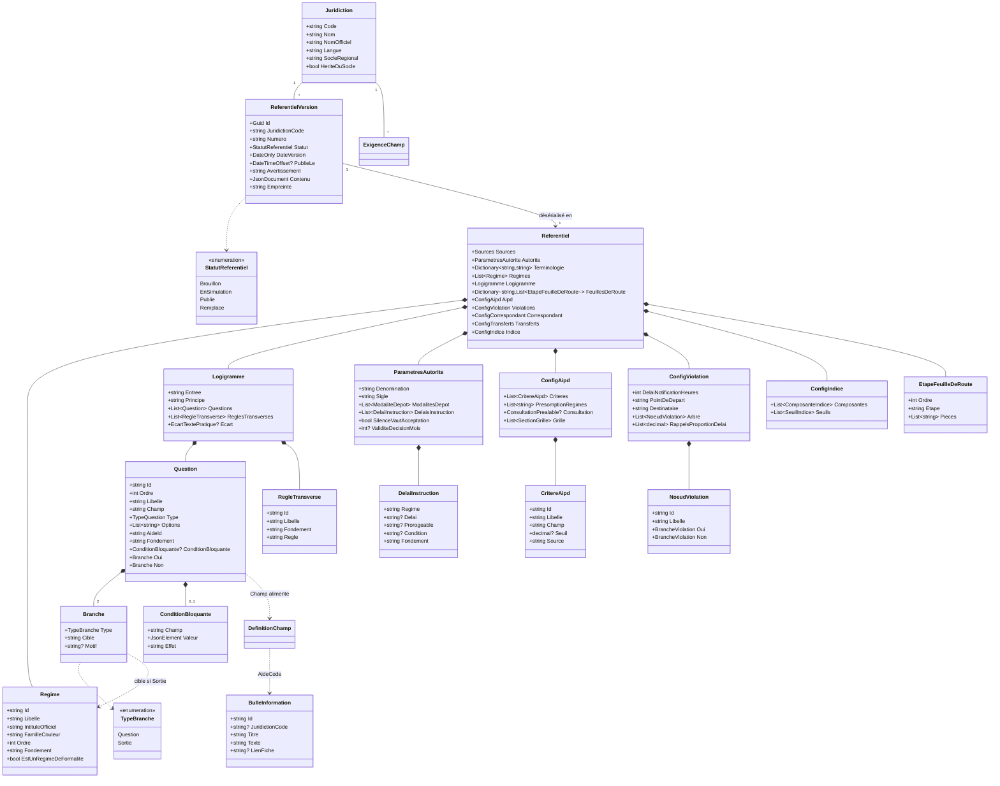
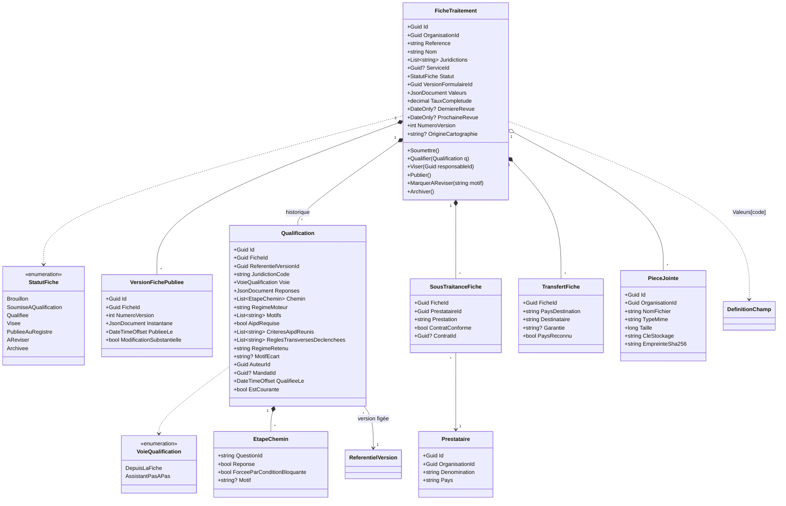
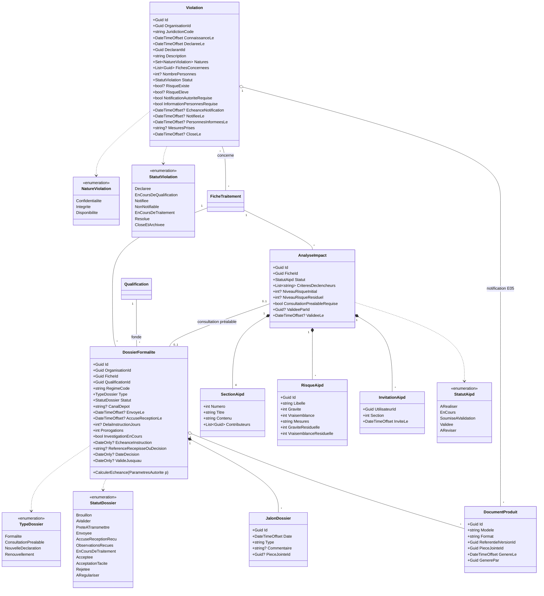
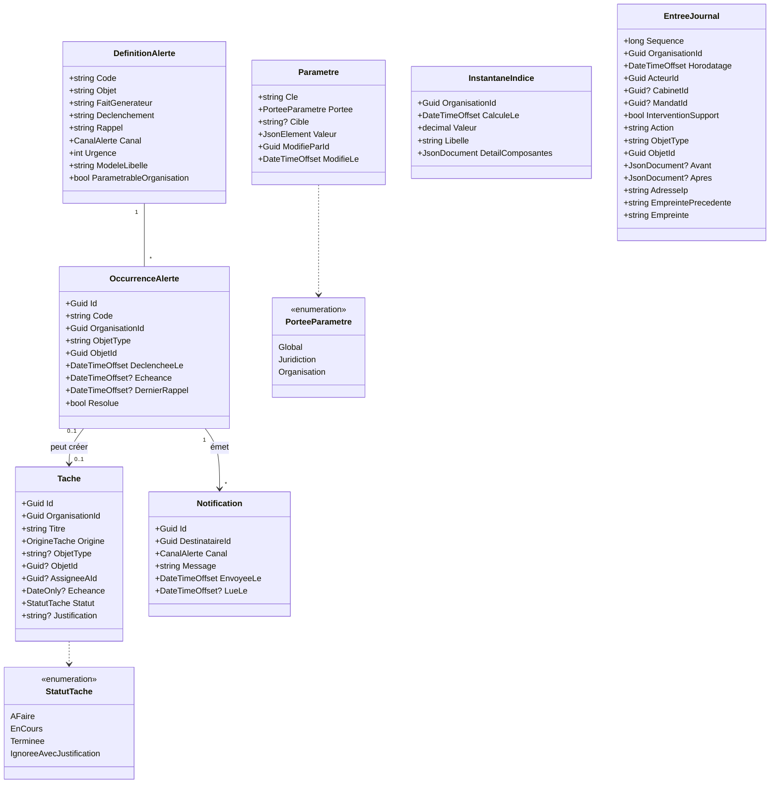
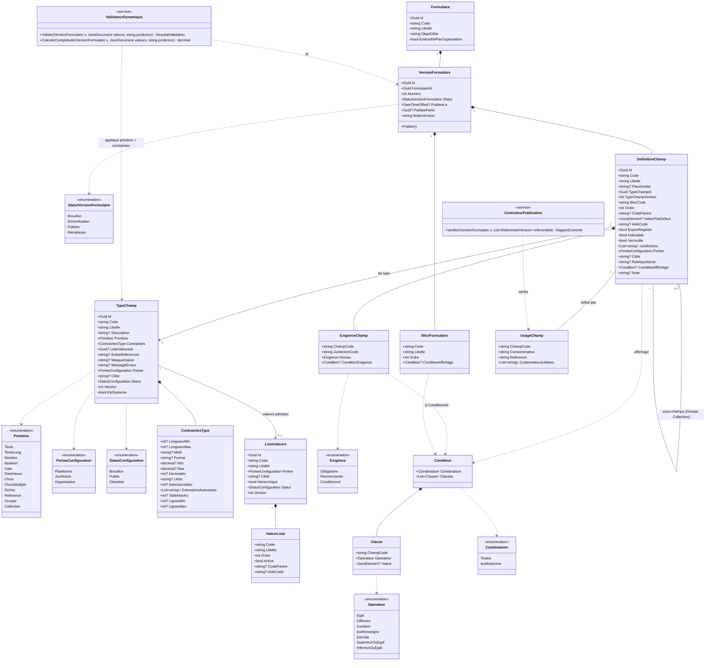

# 2. Diagrammes de classes du domaine

Conventions : types C# (.NET 10). `Guid` pour les identifiants techniques ; les codes métier
(`TG-DECLARATION`, `BJ-Q8`, `AL-03`…) sont des `string` **stables**, jamais des valeurs codées en dur.
Les noms de classes sont sans accents pour rester utilisables tels quels dans le code.
Le domaine est découpé en six paquets, qui correspondent aux modules de la solution .NET.

## 2.1 Organisations, cabinets, utilisateurs et mandats

**Invariants à garantir côté serveur**

- Un utilisateur est rattaché à **une seule** organisation **ou** à un seul cabinet (G04).
- `DesignationCorrespondant` est la désignation **légale**, distincte du rôle applicatif `Correspondant`. Seule la désignation alimente le moteur (FAQ H01, note TG-Q3).
- Un consultant agit chez un client seulement si le mandat est `Actif` **et** s'il y est nominativement affecté. Les deux conditions sont vérifiées à chaque requête (G05).
- Droits effectifs = rôle de cabinet ∩ plafond du niveau de mandat ∩ périmètre, moins les actions réservées. Le plus restrictif l'emporte (voir le flux 4.3).

## 2.2 Référentiels de juridiction

Le référentiel est stocké en JSONB dans `ReferentielVersion.Contenu`, validé par un schéma JSON,
puis désérialisé dans le modèle typé ci-dessous, en lecture seule, que consomme le moteur.

> Les **champs** et leurs **types** ne font plus partie du référentiel juridique : ils sont créés
> dans l'application et versionnés par le module Formulaires (section 2.7 et fichier 11). Le
> référentiel ne fait que les **désigner par leur code** (`Question.Champ`, `CritereAipd.Champ`).

## 2.3 Registre et qualification

**Points clés**

- `Valeurs` (JSONB) contient les champs de niveau traitement, indexés par `DefinitionChamp.Code` (`t.finalites`, `t.donnees_sensibles`…). Les champs de niveau organisation sont lus sur `Organisation` et recopiés dans l'instantané à la publication.
- Les tableaux qui nourrissent les alertes, à savoir les sous-traitants (AL-06) et les transferts (AL-07), sont des entités à part entière, interrogeables par requête. Les autres tableaux (catégories de données, durées, accès internes, droits) restent dans le JSONB.
- Un traitement peut relever de **plusieurs juridictions** (note du champ `t.juridiction`). Il reçoit alors une qualification courante **par juridiction**, avec unicité sur (fiche, juridiction) pour `EstCourante`, et autant de dossiers que nécessaire.
- Une `Qualification` n'est **jamais modifiée** : chaque requalification crée une nouvelle ligne, et `EstCourante` désigne la dernière. Elle référence la `ReferentielVersion` exacte, ce qui la rend explicable même après publication d'une nouvelle version.
- `RegimeRetenu ≠ RegimeMoteur` impose `MotifEcart` et déclenche la règle BJ-T3 (proposition de consulter l'APDP).

## 2.4 Formalités, analyses d'impact et violations

## 2.5 Pilotage : tâches, alertes, paramètres, indice et journal

**Règles portées par ces classes**

- `Parametre` est résolu de la portée la plus fine à la plus large : organisation, puis juridiction, puis global. Une valeur d'organisation **ne peut être moins protectrice** que celle de la juridiction (G07). Ce contrôle est fait à l'écriture.
- `EntreeJournal` est en **ajout seul**. `Empreinte = SHA-256(EmpreintePrecedente + contenu canonique)`, avec une chaîne par organisation. Toute altération rompt la chaîne et devient détectable.
- `InstantaneIndice` est recalculé à chaque événement qui l'affecte (publication, décision, AIPD validée, violation close). Les instantanés sont historisés pour tracer les courbes d'évolution.

## 2.6 Compléments : énumérations et objets-valeur

Types référencés par les diagrammes précédents et non détaillés plus haut.

```mermaid
classDiagram
    direction TB
    class StatutMandat {
        <<enumeration>>
        Demande
        Accepte
        Refuse
        Actif
        Suspendu
        Revoque
        Expire
    }
    class PorteeMandat {
        <<enumeration>>
        TouteLOrganisation
        ServicesOuDirections
        EntitesDuGroupe
    }
    class StatutCorrespondant {
        <<enumeration>>
        Interne
        Externe
    }
    class TypeQuestion {
        <<enumeration>>
        Booleen
        Multiple
    }
    class CanalAlerte {
        <<enumeration>>
        Application
        ApplicationEtCourriel
    }
    class OrigineTache {
        <<enumeration>>
        Alerte
        RegleTransverse
        FeuilleDeRoute
        Manuelle
    }
    class Sources {
        +TextePrincipal TextePrincipal
        +string EtatTextesApplication
        +List~ArticleCle~ ArticlesCles
        +List~string~ DoctrineAutorite
    }
    class ArticleCle {
        +string Art
        +string Objet
    }
    class ModaliteDepot {
        +string Canal
        +string? Fondement
    }
    class EcartTextePratique {
        +List~string~ SortiesConcernees
        +string Constat
        +string RegleAffichage
    }
    class ConfigCorrespondant {
        +string Denomination
        +bool DesignationObligatoire
        +string Fondement
        +string EffetSurFormalites
        +string Piece
        +string RegleMoteur
    }
    class ConfigTransferts {
        +string Principe
        +List~string~ PaysReconnus
        +string Piece
        +string FormaliteAssociee
    }
    class ConsultationPrealable {
        +string Fondement
        +string Declencheur
        +string DelaiReponse
        +string EffetMoteur
    }
    class SectionGrille {
        +int Section
        +string Titre
        +string Contenu
    }
    class BrancheViolation {
        +string Type
        +string? Cible
        +bool? NotificationAutorite
        +bool? InformationPersonnes
        +string? Motif
    }
    class ComposanteIndice {
        +string Code
        +string Libelle
        +decimal Poids
    }
    class SeuilIndice {
        +string Libelle
        +int Min
        +int Max
    }
    class ResultatQualification {
        +string JuridictionCode
        +string VersionReferentiel
        +string RegimeId
        +List~string~ Motifs
        +List~EtapeChemin~ Chemin
        +bool AipdRequise
        +List~string~ CriteresAipdReunis
        +List~string~ ReglesTransverses
        +string AutoriteSigle
        +List~EtapeFeuilleDeRoute~ FeuilleDeRoute
        +string ReserveInterpretation
    }
    class MoteurQualification {
        <<service>>
        +Qualifier(Referentiel r, ValeursFiche v, DonneesOrganisation o) ResultatQualification
        +EvaluerViolation(ConfigViolation c, bool risque, bool risqueEleve) BrancheViolation
        +CalculerIndice(ConfigIndice c, MesuresIndice m) InstantaneIndice
    }

    Sources *-- ArticleCle
    ConfigAipd *-- ConsultationPrealable
    ConfigAipd *-- SectionGrille
    ConfigIndice *-- ComposanteIndice
    ConfigIndice *-- SeuilIndice
    NoeudViolation *-- "2" BrancheViolation
    ParametresAutorite *-- ModaliteDepot
    Logigramme *-- "0..1" EcartTextePratique
    Referentiel *-- Sources
    Referentiel *-- ConfigCorrespondant
    Referentiel *-- ConfigTransferts
    MoteurQualification ..> Referentiel : lit
    MoteurQualification ..> ResultatQualification : produit
    Mandat ..> StatutMandat
    Mandat ..> PorteeMandat
    DesignationCorrespondant ..> StatutCorrespondant
    Question ..> TypeQuestion
    DefinitionAlerte ..> CanalAlerte
    Tache ..> OrigineTache
```

## 2.7 Formulaires configurables : types et champs créés dans l'application

Aucun champ ni aucun type de champ n'est codé en dur. Un administrateur les crée dans
l'application, les assemble en formulaires versionnés, puis les publie. Seules les **primitives**
(le comportement de base : saisir du texte, un nombre, une date, choisir dans une liste…) existent
dans le code, car chacune exige un composant d'affichage et un validateur. Le détail, les exemples
et les garde-fous sont dans le fichier 11.

**Ce qui change par rapport à la modélisation précédente**

- `TypeChamp` n'est plus une énumération : c'est une **entité** créée dans l'application, qui combine une primitive et des contraintes (format, bornes, liste de valeurs, extensions de fichier…).
- `DefinitionChamp` appartient à une **version de formulaire**. Son `Code` (`t.finalites`, `org.secteur`…) est stable d'une version à l'autre ; c'est la clé de stockage des valeurs et la clé utilisée par les référentiels juridiques.
- `FicheTraitement` (et `Organisation` pour les champs de niveau organisation) mémorise la **version du formulaire** avec laquelle ses valeurs ont été saisies.
- `UsageChamp` est calculé à chaque contrôle de publication : il recense qui dépend d'un champ (question du moteur, critère d'AIPD, condition bloquante, modèle de document, indice). Un champ utilisé est `Verrouille` : sa primitive ne peut plus changer et les codes de valeurs dont le moteur dépend ne peuvent pas être supprimés.
