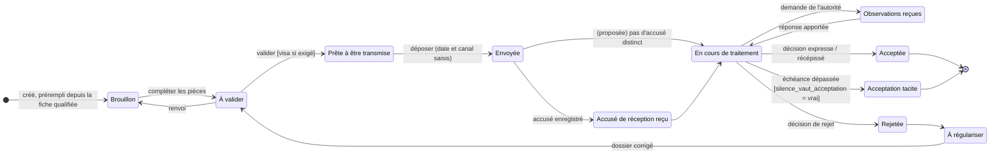
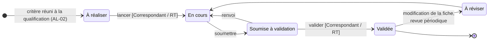
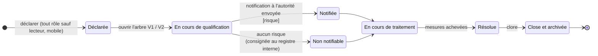
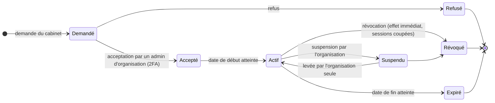
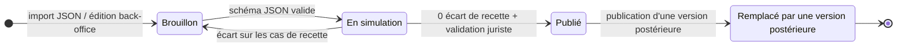
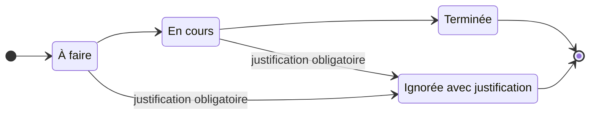

# 3. Diagrammes d'états (cycles de vie)

Les **états** sont ceux arrêtés par le livrable G03. Les **transitions** sont déduites de G03
(règles communes), de G04 (circuit de validation) et des référentiels.
Celles marquées *(proposée)* ne figurent pas expressément dans les livrables et sont à valider
par AMELEGAL.

Règle commune à tous les cycles : chaque transition est horodatée, attribuée à son auteur
(et à son cabinet et à son mandat le cas échéant) et consignée au journal de conformité.

## 3.1 Fiche de traitement

```mermaid
stateDiagram-v2
    direction LR
    [*] --> Brouillon : création (saisie, import, modèle sectoriel)
    Brouillon --> SoumiseAQualification : soumettre [champs obligatoires complets]
    SoumiseAQualification --> Brouillon : renvoi avec motif
    SoumiseAQualification --> Qualifiee : qualifier [Correspondant / RT / consultant référent]
    Qualifiee --> Brouillon : renvoi avec motif
    Qualifiee --> Visee : viser [Responsable de traitement]
    Qualifiee --> PublieeAuRegistre : publier [visa désactivé par l'organisation]
    Visee --> PublieeAuRegistre : publier [Correspondant]
    PublieeAuRegistre --> AReviser : modification substantielle,<br/>échéance de revue (AL-08),<br/>évolution du référentiel (AL-09)
    AReviser --> SoumiseAQualification : resoumettre
    Brouillon --> Archivee : archiver
    PublieeAuRegistre --> Archivee : archiver
    AReviser --> Archivee : archiver
    Archivee --> [*]

    state "Soumise à qualification" as SoumiseAQualification
    state "Qualifiée" as Qualifiee
    state "Visée" as Visee
    state "Publiée au registre" as PublieeAuRegistre
    state "À réviser" as AReviser
    state "Archivée" as Archivee
```

- Circuit **fusionné** (petites structures, G04 §4) : les étapes 2 à 4 sont réunies en une validation unique, de `Brouillon` à `Qualifiée`/`Visée`.
- Au passage à `PublieeAuRegistre`, un instantané `VersionFichePubliee` est créé et l'indice est recalculé. Si la fiche avait déjà été déclarée et que la modification est substantielle, une tâche « nouvelle déclaration » est créée (AL-13, BJ-T4).

## 3.2 Dossier de formalité

- `AcceptationTacite` n'est atteignable que si le référentiel porte `silence_vaut_acceptation = true`, c'est-à-dire au Bénin. Au Togo, l'état existe mais n'est jamais atteint (G03 §2). La transition est déclenchée par une **tâche planifiée** (voir la séquence 6.3).
- Pour un dossier `Acceptee` ou `AcceptationTacite` dont la juridiction prévoit une validité (2 ans au Bénin), `ValideJusquau` est calculé et l'alerte AL-12 est programmée à J-60 puis J-15. Elle peut ouvrir un dossier de type `Renouvellement`.

## 3.3 Analyse d'impact

Si le risque résiduel reste élevé à la validation (BJ-T2, art. 429), un `DossierFormalite` de type
`ConsultationPrealable` est créé, avec son propre compte à rebours de 8 semaines, prorogeable de 6.

## 3.4 Violation de données

- L'échéance est égale à `ConnaissanceLe` + 72 h (paramètre du référentiel). Les rappels tombent à 25, 50, 75 et 90 % du délai (AL-01, G07).
- Aucune expiration de session ne s'applique pendant la saisie d'une déclaration (G07).

## 3.5 Mandat

## 3.6 Version de référentiel

Une version `Publie` ou `Remplace` est **immuable**. Elle reste référencée par les qualifications
qui l'ont utilisée.

## 3.7 Tâche

