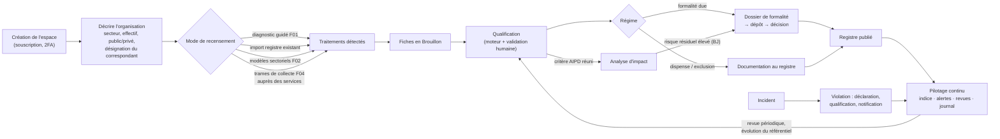
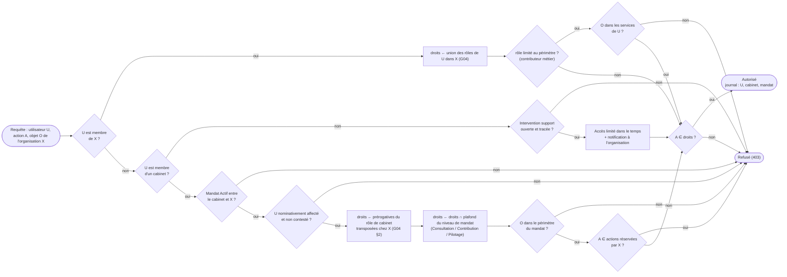
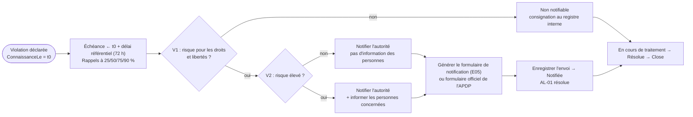
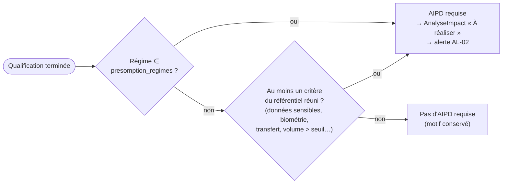
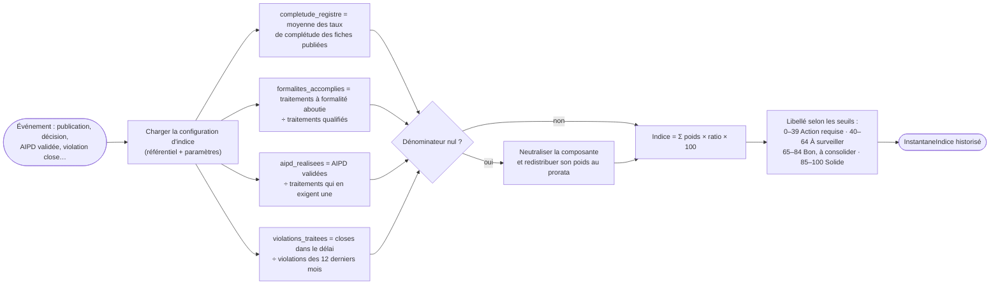

# 4. Flux et diagrammes d'activité

## 4.1 Parcours global d'une organisation

## 4.2 Algorithme d'exécution du moteur de qualification

Générique pour toutes les juridictions, il n'utilise que les données du référentiel (notice §4).

```mermaid
flowchart LR
    S(["Entrée : référentiel publié + valeurs de la fiche + données organisation"]) --> I["q ← logigramme.entree<br/>chemin ← []"]
    I --> R["Lire la valeur du champ q.champ"]
    R --> T{"q.type"}
    T -->|"booleen"| V1["rep ← valeur == vrai<br/>(absente ⇒ faux)"]
    T -->|"multiple"| V2["rep ← au moins une option cochée"]
    V1 --> CB{"q.condition_bloquante<br/>remplie ?"}
    V2 --> CB
    CB -->|"oui"| F["rep ← faux<br/>motif de forçage ajouté"]
    CB -->|"non"| B
    F --> B["branche ← rep ? q.oui : q.non<br/>chemin.ajouter(q, rep)"]
    B --> BT{"branche.type"}
    BT -->|"question"| N["q ← question(branche.cible)"] --> R
    BT -->|"sortie"| O["régime ← branche.cible<br/>motifs ← chemin + branche.motif"]
    O --> TR["Évaluer les règles transverses<br/>(ajoutent tâches / obligations,<br/>ne modifient pas le régime)"]
    TR --> AI["Évaluer les critères AIPD<br/>+ présomption par régime"]
    AI --> RES(["Résultat : juridiction, version du référentiel, régime, motifs,<br/>chemin, besoin d'AIPD, autorité, feuille de route,<br/>réserve d'interprétation (D05)"])
```

Garde-fous d'implémentation :

- Le moteur est une **fonction pure**, sans base de données ni horloge. Il est donc testable par les CSV de recette.
- Protection contre les cycles : au plus `nb_questions` itérations, sinon erreur de référentiel. Ce contrôle est aussi fait à l'import.
- Les deux voies (fiche et assistant) appellent **la même fonction**. Le test de recette compare leurs sorties (notice §7).

## 4.3 Calcul des droits effectifs (à chaque requête)

En .NET, ce flux est implémenté par un `IAuthorizationHandler` unique, alimenté par un cache des
mandats invalidé à chaque changement de statut. Une révocation coupe donc immédiatement les sessions.

## 4.4 Qualification d'une violation et compte à rebours

## 4.5 Détermination du besoin d'analyse d'impact

## 4.6 Calcul de l'indice de conformité

