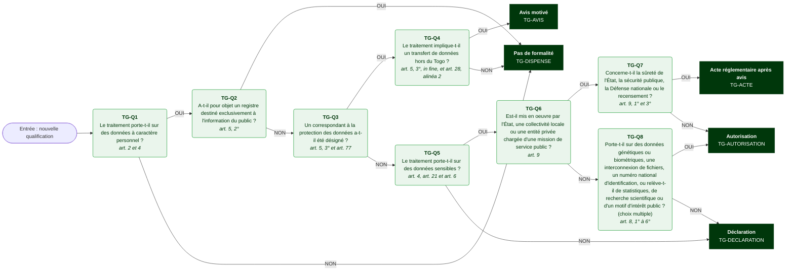
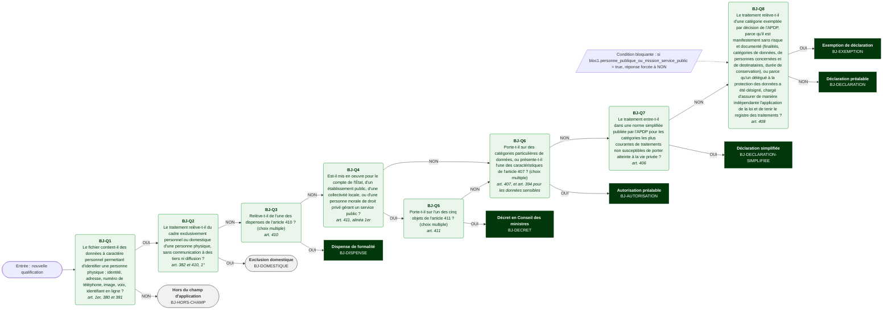

# 5. Logigrammes de qualification

> Fichier **généré** par `outils/generer_logigrammes.py` à partir des référentiels JSON. Ne pas modifier à la main : corriger le référentiel puis relancer le script.

Lecture : rectangle vert arrondi = question, rectangle sombre = régime de formalité, rectangle gris arrondi = exclusion (sans formalité), parallélogramme = condition bloquante.

## Togo — référentiel v1.0 du 2026-09-06

Autorité : **IPDCP**. Entrée : `TG-Q1`. 8 questions, 5 sorties.

### Motifs par branche — Togo

| Question | Réponse | Issue | Motif affiché |
|---|---|---|---|
| TG-Q1 | OUI | → TG-Q2 |  |
| TG-Q1 | NON | **TG-DISPENSE** | Le traitement ne porte pas sur des données à caractère personnel : il échappe au champ de la loi. |
| TG-Q2 | OUI | **TG-DISPENSE** | Le traitement a pour seul objet la tenue d'un registre destiné exclusivement à l'information du public : il est dispensé de formalités. |
| TG-Q2 | NON | → TG-Q3 |  |
| TG-Q3 | OUI | → TG-Q4 |  |
| TG-Q3 | NON | → TG-Q5 |  |
| TG-Q4 | OUI | **TG-AVIS** | La désignation d'un correspondant dispense des formalités, sauf lorsqu'un transfert vers un pays tiers est envisagé. Le transfert appelle l'avis motivé préalable de l'IPDCP. |
| TG-Q4 | NON | **TG-DISPENSE** | Un correspondant a été désigné et aucun transfert hors du Togo n'est envisagé : le traitement est dispensé de formalités préalables. |
| TG-Q5 | OUI | → TG-Q6 |  |
| TG-Q5 | NON | **TG-DECLARATION** | Le traitement ne relève d'aucun régime dérogatoire : il suit le régime de droit commun de la déclaration. |
| TG-Q6 | OUI | → TG-Q7 |  |
| TG-Q6 | NON | → TG-Q8 |  |
| TG-Q7 | OUI | **TG-ACTE** | Traitement opéré pour le compte d'une personne publique et portant sur une mission régalienne ou le recensement : il est décidé par acte réglementaire pris après avis motivé de l'IPDCP. |
| TG-Q7 | NON | **TG-AUTORISATION** | Traitement de données sensibles opéré pour le compte d'une personne publique, hors mission régalienne : il est soumis à l'autorisation préalable de l'IPDCP. |
| TG-Q8 | OUI | **TG-AUTORISATION** | Le traitement relève de l'un des cas de l'article 8 : il est soumis à l'autorisation préalable de l'IPDCP. |
| TG-Q8 | NON | **TG-DECLARATION** | Le traitement porte sur des données sensibles sans relever d'un cas d'autorisation : il suit le régime de la déclaration. |

## Bénin — référentiel v1.0 du 2026-09-06

Autorité : **APDP**. Entrée : `BJ-Q1`. 8 questions, 8 sorties.

### Règles transverses (ne modifient pas la sortie)

| Id | Règle | Fondement |
|---|---|---|
| BJ-T1 | **Analyse d'impact préalable** : Si le traitement présente un risque élevé pour les droits et libertés, réaliser une analyse d'impact avant le traitement, quelle que soit la sortie. | art. 428 |
| BJ-T2 | **Consultation préalable** : Si le risque résiduel demeure élevé après l'analyse, consulter l'APDP, qui répond dans un délai maximum de huit semaines, prorogeable de six. | art. 429 |
| BJ-T3 | **Le doute oblige à consulter** : Le responsable du traitement ou le délégué qui hésite sur le régime applicable doit consulter l'Autorité. Waɖɛ propose cette action lorsque l'utilisateur écarte le résultat du moteur. | art. 407, alinéa 2 |
| BJ-T4 | **Modification d'une déclaration** : Toute modification affectant une déclaration initiale donne lieu à une nouvelle déclaration. Une modification substantielle de la fiche déclenche une tâche de nouvelle déclaration. | art. 412 |
| BJ-T5 | **Validité des décisions** : Les décisions de l'APDP sont valables deux ans. Alerte de renouvellement à l'approche du terme. | pratique de l'APDP |

### Motifs par branche — Bénin

| Question | Réponse | Issue | Motif affiché |
|---|---|---|---|
| BJ-Q1 | OUI | → BJ-Q2 |  |
| BJ-Q1 | NON | **BJ-HORS-CHAMP** | Le fichier ne contient pas de données permettant d'identifier une personne physique : il est hors du champ du Livre cinquième. |
| BJ-Q2 | OUI | **BJ-DOMESTIQUE** | Le traitement relève du cadre exclusivement personnel ou domestique, sans communication à des tiers ni diffusion. Les conditions sont cumulatives et strictes. |
| BJ-Q2 | NON | → BJ-Q3 |  |
| BJ-Q3 | OUI | **BJ-DISPENSE** | Le traitement figure dans la liste des dispenses de l'article 410. La dispense porte sur la formalité seule : registre, information, sécurité, durées et rapport annuel demeurent. |
| BJ-Q3 | NON | → BJ-Q4 |  |
| BJ-Q4 | OUI | → BJ-Q5 |  |
| BJ-Q4 | NON | → BJ-Q6 |  |
| BJ-Q5 | OUI | **BJ-DECRET** | Traitement mis en oeuvre pour le compte d'une personne publique et portant sur l'un des cinq objets de l'article 411 : il est décidé par décret en Conseil des ministres pris après avis motivé de l'APDP, publié avec le décret. |
| BJ-Q5 | NON | → BJ-Q6 |  |
| BJ-Q6 | OUI | **BJ-AUTORISATION** | Le traitement relève de l'article 407 : il est soumis à l'autorisation préalable de l'APDP, matérialisée par un extrait de délibération. |
| BJ-Q6 | NON | → BJ-Q7 |  |
| BJ-Q7 | OUI | **BJ-DECLARATION-SIMPLIFIEE** | Le traitement entre dans une norme simplifiée publiée par l'APDP : la déclaration est simplifiée, par référence expresse à la norme. |
| BJ-Q7 | NON | → BJ-Q8 |  |
| BJ-Q8 | OUI | **BJ-EXEMPTION** | Le traitement relève d'une catégorie exemptée par décision de l'APDP. L'exemption suppose une décision de l'Autorité portant sur des catégories de traitements ; elle n'est pas un droit acquis. |
| BJ-Q8 | NON | **BJ-DECLARATION** | Le traitement ne relève d'aucune exception : il suit le régime de droit commun de la déclaration préalable à l'APDP. |
