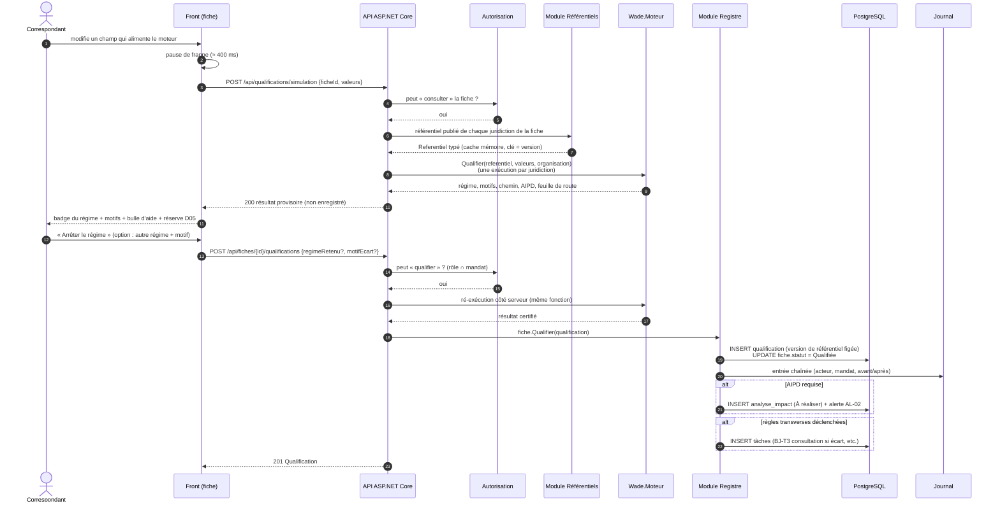
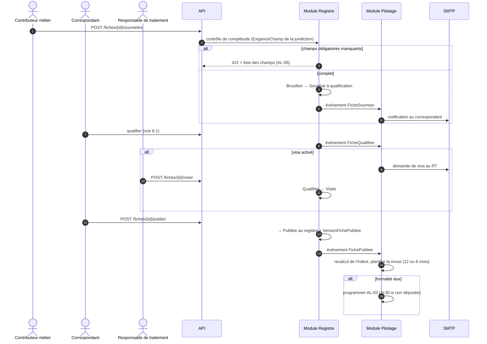
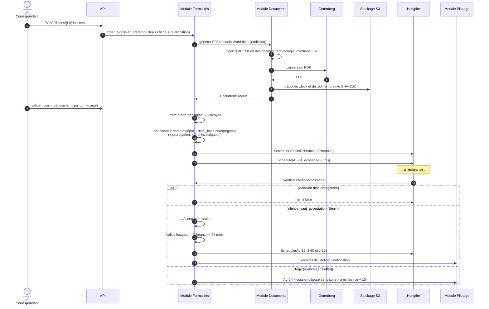
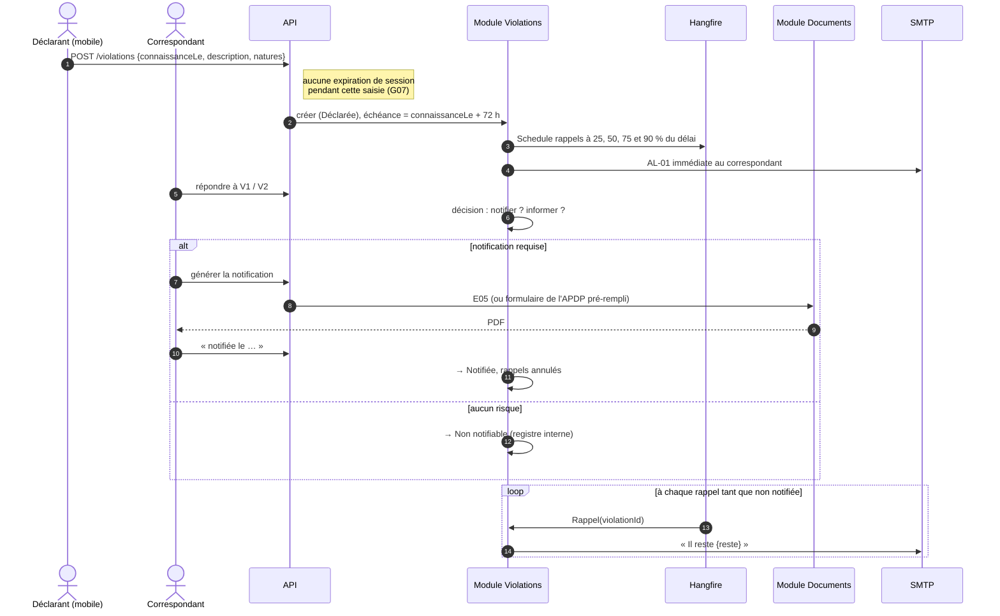
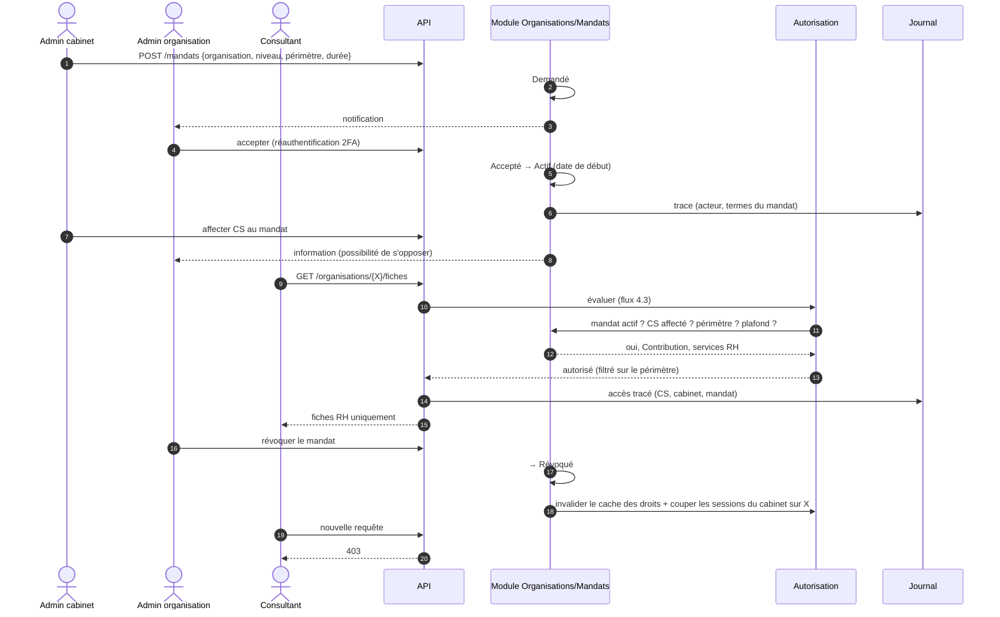
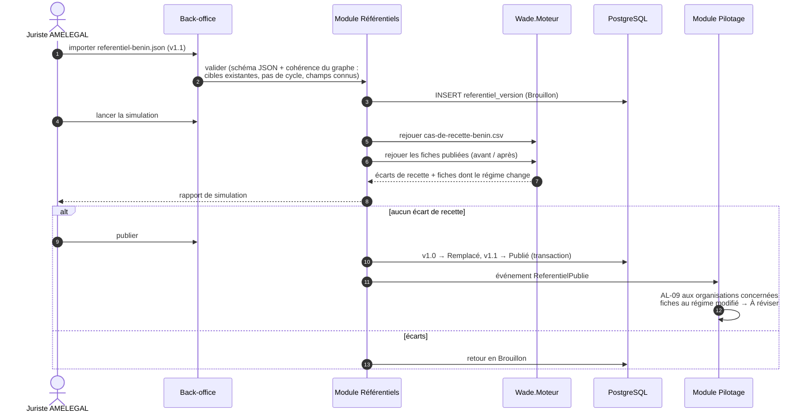

# 6. Diagrammes de séquence

Participants techniques : front (React), API (ASP.NET Core), modules de l'application,
PostgreSQL, Hangfire (tâches planifiées), stockage S3, Gotenberg et SMTP.

## 6.1 Qualification en direct pendant la saisie, puis enregistrement

## 6.2 Circuit soumission, qualification, visa, publication

## 6.3 Dossier de formalité : dépôt, délais et acceptation tacite

## 6.4 Déclaration et notification d'une violation

## 6.5 Mandat : demande, acceptation, accès d'un consultant, révocation

## 6.6 Publication d'une nouvelle version de référentiel

