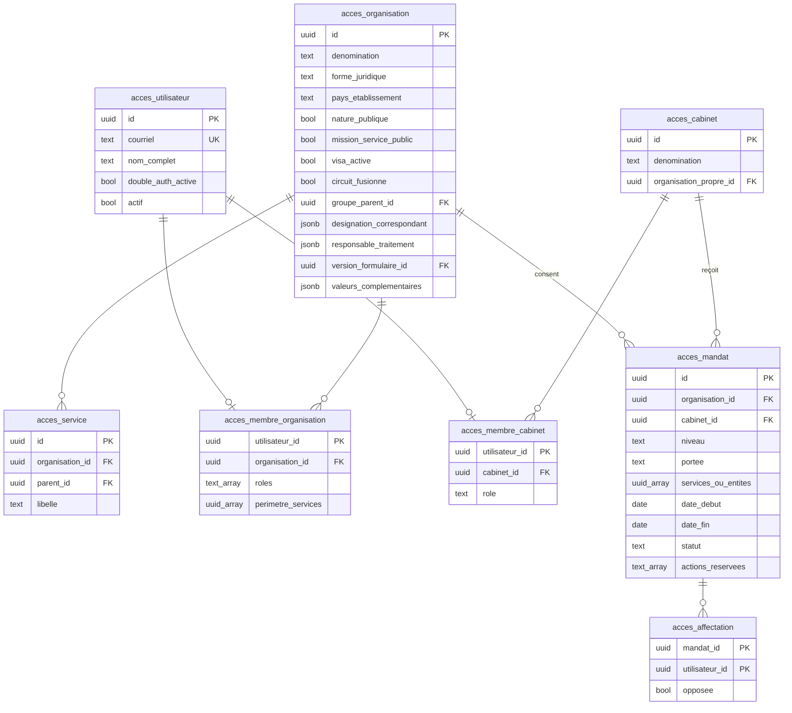
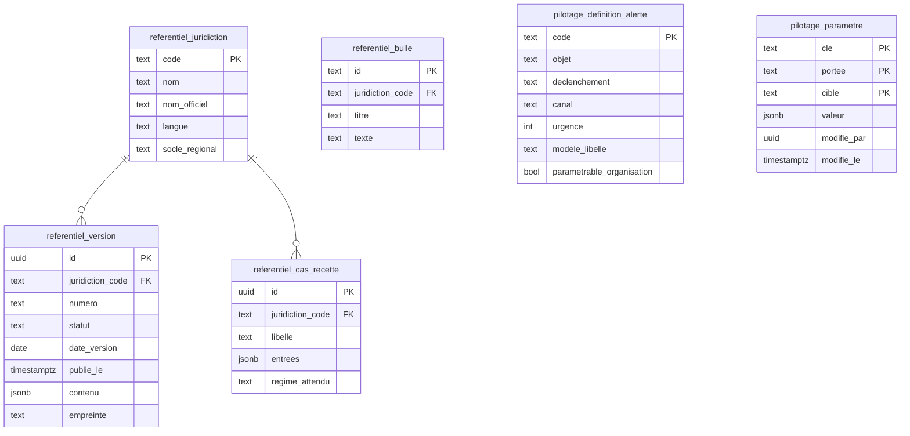
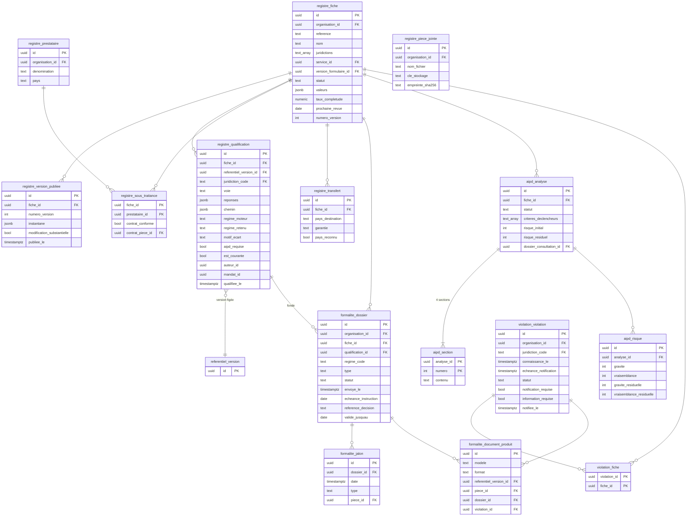
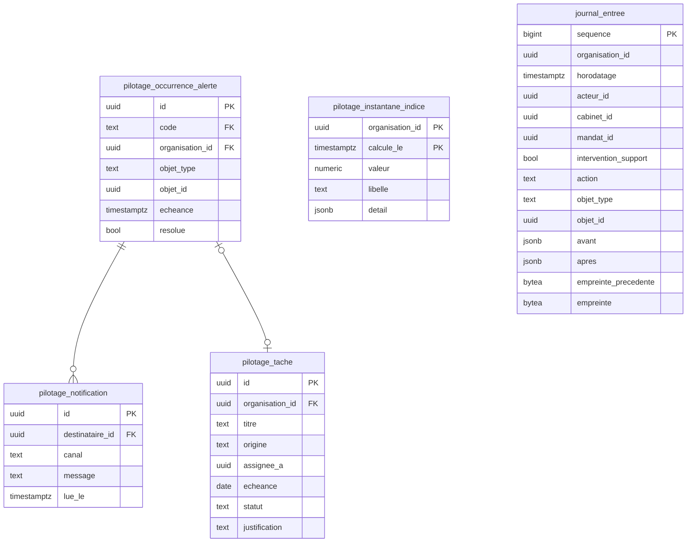

# 7. Modèle physique des données (PostgreSQL)

Une base PostgreSQL, **un schéma par module** (`acces`, `formulaire`, `referentiel`, `registre`, `formalite`,
`aipd`, `violation`, `pilotage`, `journal`). Les noms ci-dessous sont préfixés par leur schéma
(par exemple `registre_fiche` pour `registre.fiche`), parce que Mermaid n'accepte pas le point.

Toute table métier porte `organisation_id`, protégé par :

1. un **filtre global EF Core** (`HasQueryFilter`) sur l'organisation courante ;
2. une **politique RLS PostgreSQL** :
   `USING (organisation_id = current_setting('app.organisation_id')::uuid)`.
   Cette variable est fixée par l'API à chaque connexion, par un intercepteur EF Core.

## 7.1 Accès, organisations et mandats

## 7.2 Référentiels et paramètres

Contrainte : `UNIQUE (juridiction_code) WHERE statut = 'Publie'`, c'est-à-dire une seule version
publiée par juridiction.

Les définitions de champs, les types de champ et les listes de valeurs ne sont plus dans le schéma
`referentiel` : ils forment le schéma `formulaire`, détaillé en 11.8.

## 7.3 Registre, qualification, formalités, AIPD et violations

Index recommandés :

- `registre_fiche (organisation_id, statut)` ;
- un index GIN sur `registre_fiche.valeurs` (recherche par champ) ;
- `UNIQUE registre_qualification (fiche_id, juridiction_code) WHERE est_courante` ;
- `formalite_dossier (statut, echeance_instruction)` pour les tâches planifiées.

## 7.4 Pilotage et journal

`journal_entree` : l'utilisateur applicatif n'a que le droit `INSERT` (`REVOKE UPDATE, DELETE`).
La table est partitionnée par mois et une vérification nocturne de la chaîne d'empreintes est
programmée dans Hangfire.
