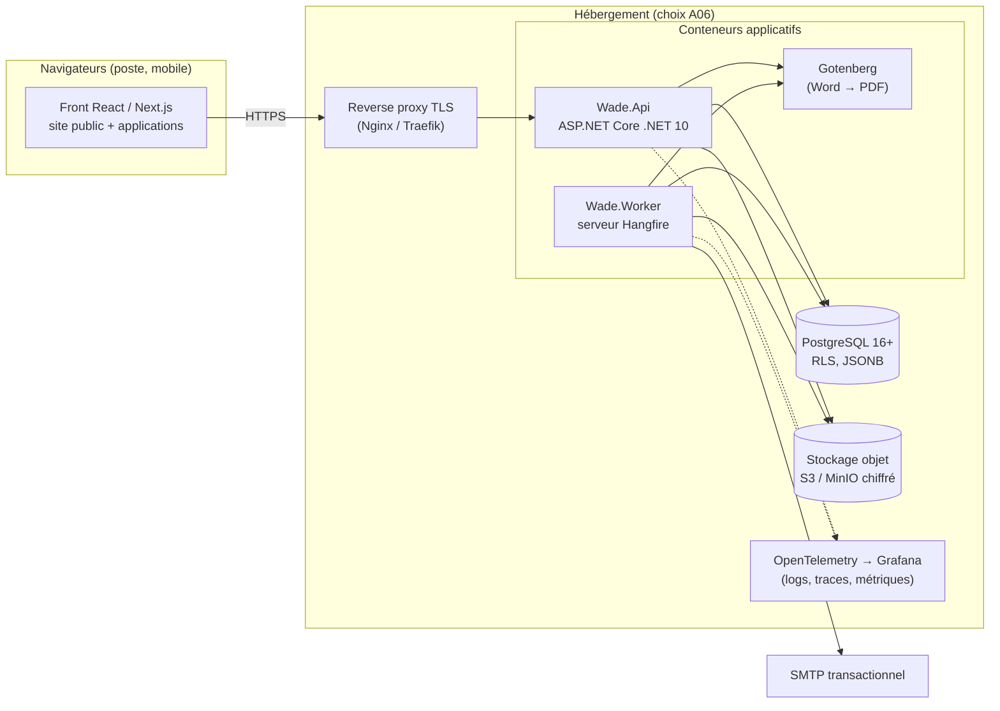
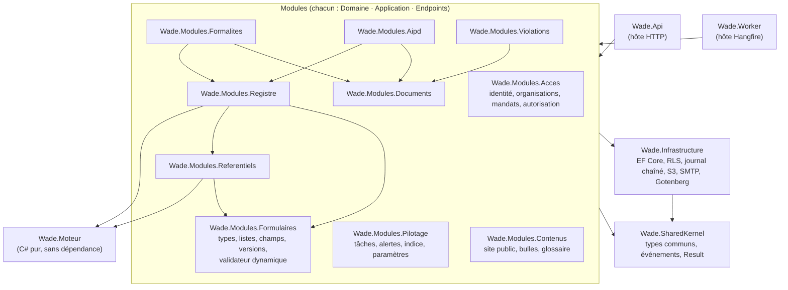

# 8. Architecture des composants (.NET)

## 8.1 Vue de déploiement

`Wade.Api` et `Wade.Worker` partagent les mêmes assemblies de modules. Seul l'hôte change :
l'un sert l'API HTTP, l'autre exécute les tâches Hangfire (alertes, échéances, vérification du
journal, conversions lourdes).

## 8.2 Dépendances entre projets de la solution

Règles de dépendance, vérifiées par un test d'architecture (NetArchTest) :

- `Wade.Moteur` ne référence **rien** : ni EF Core, ni ASP.NET. Il reste ainsi testable avec les seuls fichiers CSV de recette.
- Un module n'accède jamais aux tables d'un autre module. Il passe par son interface publique (`IRegistreLecture`…) ou par un **événement de domaine** (`FichePubliee`, `ReferentielPublie`, `ViolationDeclaree`…) diffusé en mémoire, avec une table outbox pour les effets asynchrones.
- Toute écriture passe par `DbContext.SaveChanges`. Un intercepteur y produit l'entrée de journal chaînée. Aucune écriture SQL directe hors migrations.

## 8.3 Pile technique retenue

| Besoin | Choix |
|---|---|
| API | ASP.NET Core Minimal APIs (ou contrôleurs), OpenAPI |
| Persistance | EF Core + Npgsql (JSONB, tableaux, RLS) |
| Identité | ASP.NET Core Identity, TOTP + codes de récupération, verrouillage après 5 essais (G07) |
| Autorisation | Policies + `IAuthorizationHandler` « droits effectifs » (flux 4.3) |
| Tâches planifiées | Hangfire (stockage PostgreSQL) |
| Validation des référentiels | JsonSchema.Net + contrôles de graphe |
| Formulaires dynamiques | Validateur générique piloté par la configuration (C#), même règles en TypeScript côté front ; expressions régulières avec délai maximal |
| Documents | Open XML SDK (modèles Word E01 à E07) + Gotenberg |
| Courriels | MailKit |
| Tests | xUnit, Testcontainers (PostgreSQL), recette du moteur sur les CSV, NetArchTest |
| Observabilité | OpenTelemetry, .NET Aspire en local |
| Client front | Client TypeScript généré depuis l'OpenAPI (NSwag ou Kiota) |
