# 10. Diagramme de flux complet

Le parcours de bout en bout sur une seule planche : mise en place, recensement, qualification,
analyse d'impact, formalité, pilotage continu et traitement d'une violation. Chaque étape est
colorée selon l'acteur qui l'accomplit. Les losanges sont des décisions, et les mentions
`AL-xx` renvoient aux alertes de `alertes.json`.

| Couleur | Acteur |
|---|---|
| Vert clair | Contributeur métier (ou consultant contributeur) |
| Vert foncé | Correspondant (ou consultant référent sous mandat de pilotage) |
| Bleu | Responsable de traitement |
| Violet | Administrateur d'organisation |
| Orange | Cabinet |
| Gris | Système Waɖɛ (moteur, tâches planifiées, alertes) |
| Blanc, bord pointillé | Autorité de contrôle (hors plateforme) |

La version à zoomer se trouve dans `planches/` (PDF vectoriel, SVG, PNG).

```mermaid
flowchart TB
    START(["Début : une organisation rejoint Waɖɛ"]) --> A1

    subgraph P0["0 · Mise en place"]
        direction TB
        A1["Souscrire et créer l'espace<br/>double authentification"]:::adm
        A2["Décrire l'organisation<br/>secteur, effectif, nature publique,<br/>mission de service public, pays"]:::adm
        A3["Renseigner la désignation légale<br/>du correspondant ou délégué"]:::adm
        A4["Inviter les utilisateurs<br/>rôles et périmètres de services"]:::adm
        A5{"Recours à<br/>un cabinet ?"}:::dec
        A6["Demander un mandat<br/>niveau, périmètre, durée"]:::cab
        A7{"Mandat<br/>accepté ?"}:::dec
        A8["Mandat Actif<br/>affectation nominative des consultants"]:::cab
        A9["Mandat Refusé"]:::sys
        A1 --> A2 --> A3 --> A4 --> A5
        A5 -- oui --> A6 --> A7
        A7 -- "oui (admin, 2FA)" --> A8
        A7 -- non --> A9
    end

    subgraph P1["1 · Recensement des traitements"]
        direction TB
        B1{"Mode de<br/>recensement"}:::dec
        B2["Diagnostic guidé (F01)"]:::con
        B3["Import d'un registre existant"]:::con
        B4["Modèles sectoriels (F02)"]:::con
        B5["Trames de collecte (F04)<br/>auprès des services métier"]:::con
        B6["Fiche au statut Brouillon<br/>enregistrement automatique"]:::con
        B7["Saisie des 3 blocs de la fiche<br/>aide contextuelle par bulles"]:::con
        B8["Qualification provisoire en direct<br/>régime, motifs, besoin d'AIPD"]:::sys
        B9["Soumettre à qualification"]:::con
        B10{"Champs obligatoires<br/>complets ?"}:::dec
        B11["Fiche incomplète (AL-05)<br/>liste des champs manquants"]:::sys
        B12["Soumise à qualification<br/>notification au correspondant"]:::sys
        B1 --> B2 & B3 & B4 & B5
        B2 & B3 & B4 & B5 --> B6 --> B7
        B7 <--> B8
        B7 --> B9 --> B10
        B10 -- non --> B11 --> B7
        B10 -- oui --> B12
    end

    subgraph P2["2 · Qualification et publication"]
        direction TB
        C1["Exécuter le logigramme<br/>de chaque juridiction de la fiche"]:::sys
        C2["Résultat : régime, motifs, fondement,<br/>version du référentiel, feuille de route,<br/>réserve d'interprétation (D05)"]:::sys
        C3{"Le correspondant<br/>retient le régime<br/>du moteur ?"}:::dec
        C4["Retenir un autre régime<br/>motif obligatoire"]:::cor
        C5["Tâche : consulter l'autorité<br/>(BJ-T3, le doute oblige)"]:::sys
        C6{"Fiche à<br/>compléter ?"}:::dec
        C7["Renvoi au contributeur<br/>avec motif"]:::cor
        C8["Fiche Qualifiée<br/>qualification figée et journalisée"]:::cor
        C9{"AIPD<br/>requise ?"}:::dec
        C10{"Visa activé par<br/>l'organisation ?"}:::dec
        C11["Viser la fiche"]:::rt
        C12["Publier au registre"]:::cor
        C13["Publiée au registre<br/>instantané de version, indice recalculé,<br/>revue planifiée (12 ou 6 mois)"]:::sys
        C1 --> C2 --> C6
        C6 -- oui --> C7
        C6 -- non --> C3
        C3 -- oui --> C8
        C3 -- non --> C4 --> C5 --> C8
        C8 --> C9
        C9 -- non --> C10
        C10 -- oui --> C11 --> C12
        C10 -- non --> C12
        C12 --> C13
    end

    subgraph P3["3 · Analyse d'impact"]
        direction TB
        D1["AIPD « À réaliser »<br/>alerte AL-02"]:::sys
        D2["Lancer l'analyse<br/>inviter des contributeurs"]:::cor
        D3["Remplir les 4 sections :<br/>description, nécessité et proportionnalité,<br/>risques, mesures"]:::con
        D4["Coter les risques<br/>gravité × vraisemblance,<br/>initial puis résiduel"]:::cor
        D5["Soumettre à validation"]:::cor
        D6{"Analyse<br/>validée ?"}:::dec
        D7["AIPD Validée<br/>rapport E04 généré"]:::cor
        D8{"Risque résiduel élevé ?<br/>(Bénin, art. 429)"}:::dec
        D9["Dossier de consultation préalable<br/>délai de 8 semaines, prorogeable de 6"]:::sys
        D1 --> D2 --> D3 --> D4 --> D5 --> D6
        D6 -- "non : renvoi" --> D3
        D6 -- oui --> D7 --> D8
        D8 -- oui --> D9
    end

    subgraph P4["4 · Formalité auprès de l'autorité"]
        direction TB
        E1{"Le régime est-il<br/>une formalité ?"}:::dec
        E2["Dispense ou exclusion<br/>documentée au registre"]:::sys
        E3["Créer le dossier<br/>prérempli depuis la fiche"]:::cor
        E4["Générer les documents (E03)<br/>modèle de la juridiction, Word et PDF"]:::sys
        E5["Compléter les pièces<br/>selon la feuille de route"]:::cor
        E6["Valider : dossier prêt<br/>à être transmis"]:::cor
        E7["Déposer auprès de l'autorité<br/>voie électronique, postale ou guichet"]:::cor
        E8["Dossier Envoyé<br/>échéance d'instruction calculée"]:::sys
        E9["Instruction du dossier"]:::aut
        E10{"Suite donnée<br/>par l'autorité ?"}:::dec
        E11["Observations reçues<br/>répondre à l'autorité"]:::cor
        E12["Dossier Accepté<br/>récépissé ou décision enregistrés"]:::cor
        E13["Dossier Rejeté<br/>À régulariser"]:::cor
        E14{"Silence vaut<br/>acceptation ?"}:::dec
        E15["Acceptation tacite<br/>(Bénin)"]:::sys
        E16["Dossier déposé sans suite (AL-04)<br/>relancer l'autorité (Togo)"]:::sys
        E17{"Validité limitée ?<br/>(Bénin : 2 ans)"}:::dec
        E18["Décision arrivant à expiration (AL-12)<br/>J-60 puis J-15"]:::sys
        E19["Dossier de renouvellement"]:::cor
        E20["Formalité qualifiée non déposée (AL-03)<br/>30 jours après la qualification"]:::sys
        E1 -- non --> E2
        E1 -- oui --> E3 --> E4 --> E5 --> E6 --> E7 --> E8 --> E9 --> E10
        E3 -.-> E20
        E20 -.-> E7
        E10 -- observations --> E11 --> E9
        E10 -- "acceptation" --> E12
        E10 -- rejet --> E13 --> E5
        E10 -- "aucune réponse<br/>à l'échéance" --> E14
        E14 -- oui --> E15
        E14 -- non --> E16 --> E9
        E12 --> E17
        E15 --> E17
        E17 -- oui --> E18 --> E19 --> E4
    end

    subgraph P5["5 · Pilotage continu"]
        direction TB
        F1["Tableau de bord<br/>indice de conformité,<br/>prochaine action prioritaire"]:::sys
        F2["Tâches et alertes<br/>rappels, tâche en retard (AL-11)"]:::sys
        F3["Journal de conformité<br/>chaque action horodatée et chaînée"]:::sys
        F4{"Événement<br/>de révision ?"}:::dec
        F5["Échéance de revue<br/>périodique (AL-08)"]:::sys
        F6["Modification substantielle<br/>d'une fiche publiée"]:::con
        F7["Nouvelle version<br/>du référentiel (AL-09)"]:::sys
        F8["Fiche « À réviser »"]:::sys
        F9{"Fiche déjà déclarée<br/>et modification<br/>substantielle ?"}:::dec
        F10["Nouvelle déclaration requise<br/>(AL-13, BJ-T4)"]:::sys
        F11["Contrôles permanents :<br/>sous-traitant sans contrat (AL-06),<br/>transfert non encadré (AL-07),<br/>mandat à échéance (AL-10)"]:::sys
        F1 --- F2 --- F3
        F2 --- F11
        F1 --> F4
        F4 --> F5 & F6 & F7
        F5 & F6 & F7 --> F8 --> F9
        F9 -- oui --> F10
    end

    subgraph P6["6 · Violation de données"]
        direction TB
        G0(["Incident constaté"])
        G1["Déclarer la violation<br/>y compris sur mobile,<br/>date de prise de connaissance"]:::con
        G2["Échéance = connaissance + 72 h<br/>alerte AL-01, rappels à 25, 50, 75 et 90 %"]:::sys
        G3{"V1 : risque pour les droits<br/>et libertés ?"}:::dec
        G4["Non notifiable<br/>consignée au registre interne"]:::cor
        G5{"V2 : risque<br/>élevé ?"}:::dec
        G6["Notifier l'autorité<br/>formulaire E05 ou officiel"]:::cor
        G7["Notifier l'autorité<br/>et informer les personnes concernées"]:::cor
        G8["Violation Notifiée<br/>rappels annulés"]:::sys
        G9["Mesures correctives<br/>En cours de traitement"]:::cor
        G10["Résolue, puis Close et archivée"]:::cor
        G0 --> G1 --> G2 --> G3
        G3 -- non --> G4 --> G9
        G3 -- oui --> G5
        G5 -- non --> G6 --> G8
        G5 -- oui --> G7 --> G8
        G8 --> G9 --> G10
    end

    A5 -- non --> B1
    A8 --> B1
    A9 --> B1
    B12 --> C1
    C7 --> B7
    C9 -- oui --> D1
    D7 --> C10
    D8 -- non --> C10
    D9 --> E8
    C13 --> E1
    E2 --> F1
    E12 --> F1
    E15 --> F1
    F8 --> B9
    F10 --> E3
    G10 --> F1
    F1 --> FIN(["Conformité pilotée dans la durée"])

    classDef con fill:#EAF5EC,stroke:#00901D,color:#00370B
    classDef cor fill:#00370B,stroke:#00370B,color:#ffffff
    classDef rt fill:#DCE9FB,stroke:#2A5DB0,color:#12305f
    classDef adm fill:#ECE1F7,stroke:#6B3FA0,color:#3b1f63
    classDef cab fill:#FDEBD3,stroke:#C97A12,color:#6b3f05
    classDef sys fill:#EEF0EF,stroke:#7b857e,color:#26302a
    classDef aut fill:#ffffff,stroke:#555555,color:#333333,stroke-dasharray: 5 4
    classDef dec fill:#FFF9E0,stroke:#B7791F,color:#5a3d0a
```

