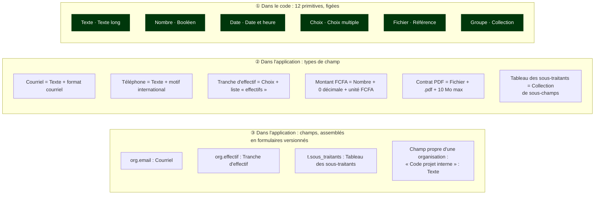
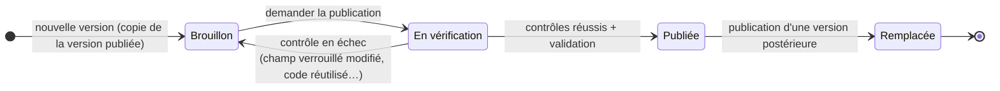
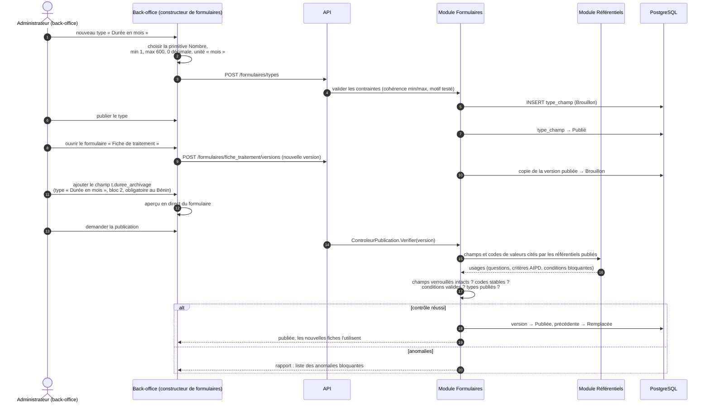
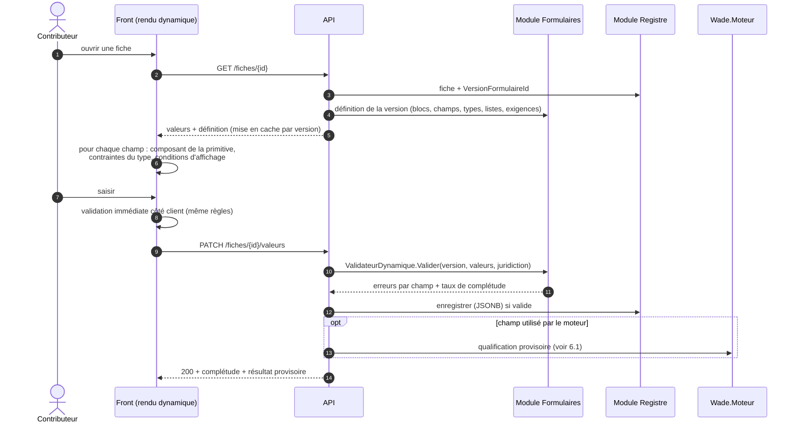
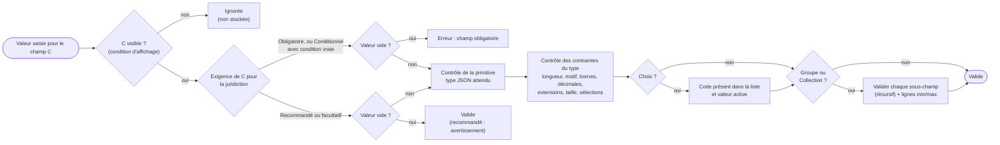
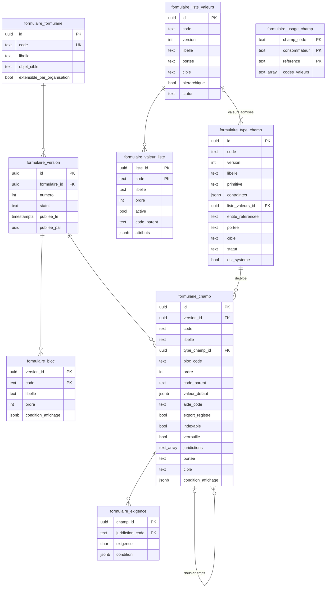

# 11. Formulaires configurables

**Objectif :** les champs du registre, de l'organisation et des autres formulaires, **y compris
leur type**, se créent directement dans l'application, sans développement ni redéploiement.
C'est le prolongement de la règle cardinale de la notice (« aucune valeur dans le code ») aux
formulaires eux-mêmes.

## 11.1 Le principe : trois niveaux

Un type de champ ne peut pas être entièrement libre : il faut bien qu'un composant sache
afficher la saisie et qu'un validateur sache la contrôler. On sépare donc ce qui relève du code
de ce qui relève de la configuration.

| Niveau | Qui le crée | Exemples |
|---|---|---|
| **Primitive** (code) | Les développeurs, une fois pour toutes | Texte, Nombre, Choix, Collection… Ajouter une primitive est le seul cas qui demande un développement. |
| **Type de champ** (application) | Administrateur back-office, ou administrateur d'organisation pour sa portée | « Numéro RCCM », « Tranche d'effectif », « Durée en mois », « Pièce justificative PDF » |
| **Champ** (application) | Juriste AMELEGAL pour les champs réglementaires, administrateur d'organisation pour ses champs propres | `t.finalites`, `t.donnees_sensibles`, « Code projet interne » |

### Les 12 primitives

| Primitive | Contraintes paramétrables dans l'application | Stockage JSON |
|---|---|---|
| Texte | longueur min/max, motif (expression régulière), format prédéfini (courriel, URL, téléphone), masque de saisie | `"chaîne"` |
| Texte long | longueur min/max | `"chaîne"` |
| Nombre | min, max, nombre de décimales, unité | `12.5` |
| Booléen | libellés oui/non | `true` |
| Date, Date et heure | bornes (avant/après une date ou aujourd'hui) | `"2026-11-13"` |
| Choix | liste de valeurs | `"code"` |
| Choix multiple | liste de valeurs, nombre max de sélections | `["code1","code2"]` |
| Fichier | extensions autorisées, taille max, nombre max | `["id-pièce"]` |
| Référence | entité visée : prestataire, service, utilisateur, pays, autre fiche | `"id"` |
| Groupe | sous-champs | `{ "souschamp": … }` |
| Collection (tableau) | sous-champs (colonnes), lignes min/max | `[{…},{…}]` |

`Groupe` et `Collection` permettent de composer des types complexes **sans code** : le
« tableau des catégories de données », le « tableau des durées de conservation » ou le « tableau
des transferts » du registre sont des collections dont les colonnes sont elles-mêmes des champs.

## 11.2 Exemples tirés de `registre-champs.csv`

Les 70 champs actuels deviennent la **configuration initiale**, chargée par import du CSV. Plus
rien de ce qu'ils décrivent n'est figé dans le code.

| Champ | Type dans le CSV | Type de champ créé | Primitive et contraintes |
|---|---|---|---|
| `org.email` | courriel | Courriel | Texte, format courriel |
| `org.telephone` | telephone | Téléphone | Texte, motif `^\+?[0-9 ]{8,20}$` |
| `org.effectif` | tranche | Tranche d'effectif | Choix, liste « effectifs » |
| `org.forme_juridique` | liste | Forme juridique | Choix, liste « formes juridiques » (SA, SARL…) |
| `t.finalites` | liste multiple | Finalités | Choix multiple, liste hiérarchique « finalités / sous-finalités » |
| `t.caracteristiques_article_407` | liste multiple | Caractéristiques art. 407 (BJ) | Choix multiple, liste dont les codes sont **utilisés par BJ-Q6** |
| `t.volume_personnes` | tranche | Volume de personnes | Choix, liste « volumes » ; chaque valeur porte sa borne basse, ce qui règle l'écart n° 5 |
| `t.sous_traitants` | tableau | Tableau des sous-traitants | Collection : prestataire (Référence), prestation (Texte), contrat conforme (Booléen), contrat (Fichier PDF) |
| `dpo.justificatif` | fichier | Pièce justificative | Fichier, PDF/JPG/PNG, 10 Mo |

## 11.3 Ce que l'application garantit malgré la liberté de configuration

La souplesse ne doit pas casser le moteur de qualification, les exports ni les données déjà
saisies. Six garde-fous sont appliqués **à la publication** d'une version de formulaire ou d'un
type :

1. **Champs utilisés par le moteur, verrouillés.** Un champ cité par une question du logigramme, une condition bloquante, un critère d'AIPD ou l'indice ne peut ni changer de primitive, ni perdre une valeur dont le code est cité par le référentiel (par exemple `donnees_biometriques`). Le contrôle croise automatiquement les référentiels publiés : c'est exactement le contrôle qui a révélé les écarts n° 1 et 2 du README, désormais bloquant.
2. **Codes stables.** Le code d'un champ et le code d'une valeur de liste sont immuables une fois publiés. On peut renommer le libellé, désactiver une valeur, jamais réutiliser un code.
3. **Pas de modification destructive en place.** Changer la primitive d'un champ qui a déjà des données est refusé. On crée un nouveau champ et on rend l'ancien obsolète ; un assistant propose de convertir les valeurs quand c'est possible (Texte vers Choix par correspondance, par exemple).
4. **Versions de formulaire immuables.** Chaque fiche mémorise la version avec laquelle elle a été saisie. Une fiche ancienne reste lisible et exportable telle qu'elle était, comme une qualification reste explicable avec son ancienne version de référentiel.
5. **Portée et cloisonnement.** Un champ ou un type de portée « Organisation » n'est visible que de cette organisation. Il ne peut **jamais** alimenter le moteur, et il n'apparaît dans les exports réglementaires que si l'organisation le décide (`ExportRegistre`).
6. **Sécurité des motifs.** Les expressions régulières saisies par les administrateurs sont exécutées avec un délai maximal (protection contre les motifs pathologiques) et testées sur des exemples avant publication.

## 11.4 Cycle de vie d'une version de formulaire

Les types de champ et les listes de valeurs suivent le cycle plus simple
`Brouillon → Publié → Obsolète`. Un type obsolète reste valable pour les champs qui l'utilisent
déjà, mais ne peut plus être choisi pour un nouveau champ.

## 11.5 Séquence : créer un type de champ et l'utiliser dans le registre

## 11.6 Séquence : saisie d'une fiche avec un formulaire dynamique

## 11.7 Flux de validation d'une valeur

Le même algorithme sert côté serveur (C#) et côté client (TypeScript). Il est piloté uniquement
par la configuration.

## 11.8 Tables PostgreSQL du module Formulaires

Contraintes et index :

- `UNIQUE (code, version)` sur les types et les listes ; `UNIQUE (version_id, code)` sur les champs.
- Un seul `formulaire_version` au statut `Publiee` par formulaire **et par organisation** pour les extensions (index unique partiel).
- Les valeurs restent dans `registre_fiche.valeurs` (JSONB), indexées par code de champ. Les champs marqués `Indexable` sont couverts par l'index GIN `jsonb_path_ops` ; aucune colonne n'est créée dynamiquement, il n'y a donc **jamais de migration de schéma** quand un administrateur ajoute un champ.
- `registre_fiche` et `acces_organisation` portent `version_formulaire_id`.

## 11.9 Conséquences sur les autres modules

| Module | Conséquence |
|---|---|
| Référentiels | Ne définissent plus les champs : ils les citent par **code**. La publication d'un référentiel vérifie que chaque code cité existe dans le formulaire publié avec une primitive compatible (booléen pour une question `booleen`, choix multiple pour `multiple`, codes d'options présents). |
| Moteur | Inchangé : il lit des valeurs par code. Seul le résolveur de champ calculé (`personne_publique_ou_mission_service_public`, écart n° 2) devient un champ de type « Calculé » ou une règle déclarée dans le référentiel. |
| Documents | Les modèles Word citent les champs par code (`{{t.finalites}}`). Une section générique « Autres informations » liste automatiquement les champs ajoutés et marqués `ExportRegistre`, sans modifier le modèle. |
| Indice | La complétude du registre est calculée par le `ValidateurDynamique` sur les exigences de la version en vigueur. |
| Front | Un composant par primitive et un moteur de rendu générique. Le constructeur de formulaires du back-office (glisser-déposer des champs, aperçu en direct) utilise ce même rendu. |
| Journal | Toute création ou publication de type, liste, champ ou version est journalisée comme les autres actions. |

## 11.10 Décisions à confirmer

1. **Les organisations peuvent-elles créer leurs propres champs et types ?** La modélisation le permet (portée « Organisation », formulaire `ExtensibleParOrganisation`), cantonné à un bloc « Informations complémentaires » qui n'alimente jamais le moteur. À désactiver si seul AMELEGAL doit configurer.
2. **Quels formulaires sont configurables ?** Proposé : fiche de traitement, organisation, déclaration de violation, sections d'AIPD, dossier de formalité. Les écrans de gouvernance (mandats, rôles) restent fixes, car leurs règles relèvent du contrôle d'accès.
3. **Faut-il une primitive « Calculé »** (valeur dérivée d'autres champs par une expression), pour des cas comme `personne_publique_ou_mission_service_public` ? C'est la seule extension qui introduirait un petit langage d'expressions ; l'alternative est de déclarer ces dérivations dans le référentiel juridique.
