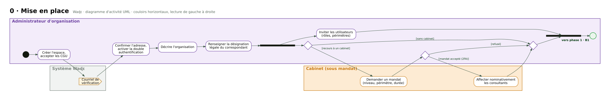
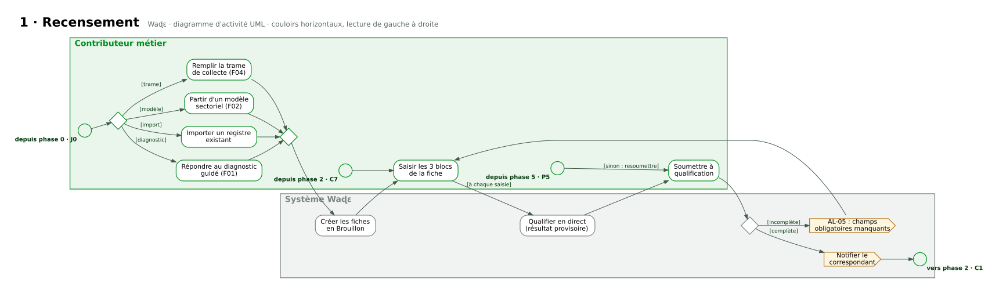
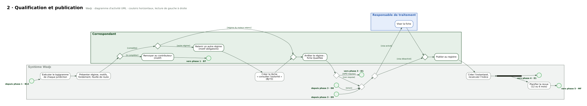
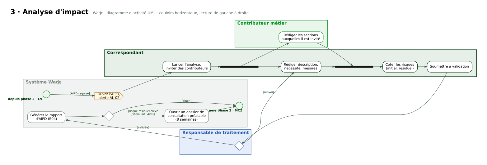
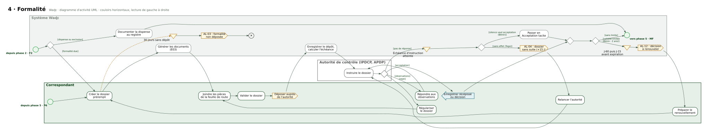
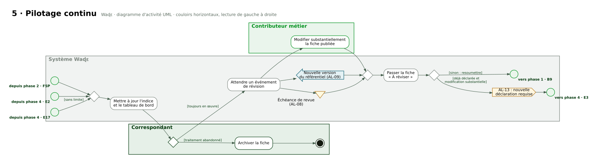
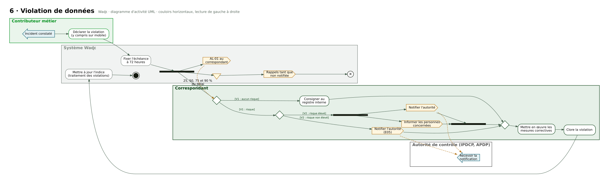

# 12. Diagramme d'activité UML

Le parcours complet d'une organisation dans Waɖɛ en notation UML 2 : un **couloir horizontal par
acteur**, des décisions gardées (`[condition]`), des fourches et jonctions pour les chemins menés en
parallèle, des signaux (alertes, notifications, dépôt) et des événements temporels (échéances).

L'activité est découpée en **un diagramme par phase**, reliés par des **connecteurs** (petits
cercles verts « vers phase… » / « depuis phase… »), comme le prévoit UML pour les grandes activités.
L'ensemble couvre les 118 nœuds et les 146 flots du modèle.

- Document complet : [`Waɖɛ_Diagramme_activite.pdf`](Waɖɛ_Diagramme_activite.pdf) (couverture, notation, vue d'ensemble, puis une page par phase à sa taille réelle).
- Source unique : [`outils/activite_donnees.py`](outils/activite_donnees.py) ; génération : `python3 _modélisation/outils/generer_activite.py`.
- Les identifiants (A1, B7, E14…) sont ceux du diagramme de flux (fichier 10) et de son document explicatif.

## Couloirs

Administrateur d'organisation · Cabinet (sous mandat) · Contributeur métier · Correspondant ·
Responsable de traitement · Système Waɖɛ · Autorité de contrôle (IPDCP, APDP).

Un consultant de cabinet agit dans les couloirs « Contributeur métier » ou « Correspondant » selon
son rôle et le niveau de son mandat ; le couloir « Cabinet » ne montre que ce qui lui est propre.

## Les diagrammes

### 0 · Mise en place

### 1 · Recensement

### 2 · Qualification et publication

### 3 · Analyse d'impact

### 4 · Formalité

### 5 · Pilotage continu

### 6 · Violation de données

